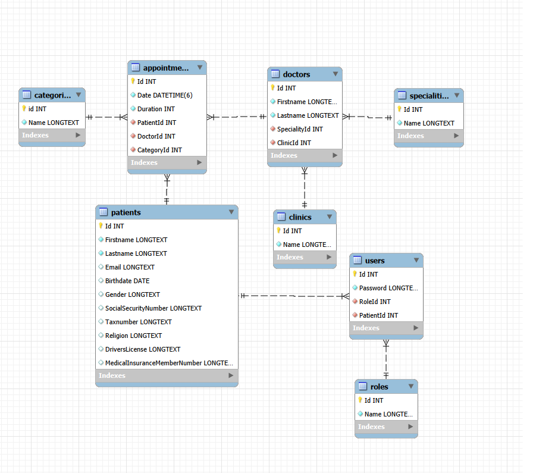

# Noroff school Exam project 2 : Clinic API
My project was taken from the schools git Repo that i submitted it to orginally, hence the lack of commits on mine.

# Scenario

This project required me to build a Clinic API with a front and backend that lets guests and registered / logged in users be able to search for their disered doctor/speciality and book an appointment with
said doctor and clinic. Logged in users will be able to see and manage their booked appointment where guests would have limited access due to not being registered.

The front end was made with React / next.js  using typescript.

The backend was mae with ASP.NET Core along with using entity framework to create the local MYSQL database that was required to be in (NF3) to hold patient data 

# Application setup and instructions 

The application setup and instructions are in the Readme files for both the backend and frontend folders along with the used libaries/packages.

